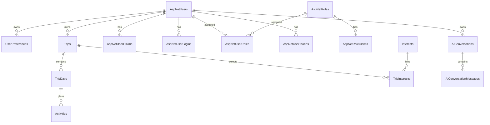

# التوثيق التقني الكامل لمشروع SkyMate

## منصة تخطيط السفر الذكية والمساعد السياحي

**الإصدار:** 1.0  
**تاريخ الإعداد:** 17 نوفمبر 2026  
**نطاق التوثيق:** التنفيذ الموجود في مستودع المشروع عند تاريخ الإعداد

---

## تمهيد ونطاق التوثيق

يشرح هذا المستند بنية Backend في SkyMate باستخدام ASP.NET Core Web API و.NET 10، نموذج البيانات ومهاجرات EF Core، مسارات API والمصادقة، وإدارة المحادثات ومساعد السفر المعتمد على مزود LLM قابل للاستبدال.

لا يوجد في الحل عميل React أو Flutter. عُثر على تسليم فريق AI الأصلي في ملف `New.rtf` المرفق، وأُدمجت تعليماته ومواد قاعدة المعرفة في تنفيذ المساعد الحالي. هذا التحديث أضاف تعديلات نموذج البيانات اللازمة، لكنه لم ينشئ migration لهذه التعديلات ولم يتصل بـ SQL Server أو يغير قاعدة بيانات.

تعني عبارة **«موجود في المصدر»** أن السلوك يظهر في الملفات الحالية. وتعني **«غير متحقق منه»** أن الكود لا يكفي لإثبات حالة تشغيلية خارج المستودع، مثل تطبيق migration على قاعدة الإنتاج. المسارات المذكورة نسبية إلى مجلد المشروع `D:\Skymate v1`.

## المحتويات

1. [مقدمة المشروع](#الفصل-1-مقدمة-المشروع)
2. [معمارية النظام](#الفصل-2-معمارية-النظام)
3. [الحل وبنية المجلدات](#الفصل-3-الحل-وبنية-المجلدات)
4. [تصميم قاعدة البيانات وERD](#الفصل-4-تصميم-قاعدة-البيانات-وerd)
5. [Entity Framework Core وتنفيذ قاعدة البيانات](#الفصل-5-entity-framework-core-وتنفيذ-قاعدة-البيانات)
6. [المصادقة والتفويض](#الفصل-6-المصادقة-والتفويض)
7. [توثيق API](#الفصل-7-توثيق-api)
8. [إدارة الرحلات وخطة الأيام](#الفصل-8-إدارة-الرحلات-وخطة-الأيام)
9. [Chatbot وإدارة المحادثات](#الفصل-9-chatbot-وإدارة-المحادثات)
10. [الإعداد وبدء التطبيق](#الفصل-10-الإعداد-وبدء-التطبيق)
11. [الأخطاء والتحقق من البيانات](#الفصل-11-الأخطاء-والتحقق-من-البيانات)
12. [الاختبارات](#الفصل-12-الاختبارات)
13. [الأمان](#الفصل-13-الأمان)
14. [الميزات المنفذة والميزات المنتظرة](#الفصل-14-الميزات-المنفذة-والميزات-المنتظرة)
15. [القرارات التقنية المهمة](#الفصل-15-القرارات-التقنية-المهمة)
16. [القيود والمشكلات المعروفة](#الفصل-16-القيود-والمشكلات-المعروفة)
17. [تشغيل Backend محليًا](#الفصل-17-تشغيل-backend-محليًا)
18. [مراحل التطوير التالية](#الفصل-18-مراحل-التطوير-التالية)
19. [مسرد المصطلحات](#الفصل-19-مسرد-المصطلحات)

---

# الفصل 1: مقدمة المشروع

## 1.1 ما هو SkyMate؟

SkyMate هو Backend لمنصة سفر. يوفّر API للحساب وقراءة الرحلات، كما يحفظ محادثات المساعد لكل مستخدم بشكل مستقل عن الرحلات. نموذج المجال يصف أيضًا التفضيلات والاهتمامات وخطة الأيام، لكن لا توجد مسارات API لإدارة كل هذه البيانات.

تعمل واجهة ASP.NET Core Web API مع أي عميل يرسل JSON وJWT. لا يوجد مشروع عميل Web أو Mobile في الحل. مسار الرسائل يرسل سجل المحادثة المحلي إلى Gemini ويخزن رسالة المستخدم ورد المساعد، ولا يعتمد استمرار المحادثة على وجود رحلة نشطة.

## 1.2 المشكلة والأهداف

الفكرة المستهدفة هي تجميع بيانات الرحلة وخطتها وتفضيلات المسافر ومحادثته في مكان واحد. التنفيذ المتاح يضع أساسًا تقنيًا لهذه الفكرة عبر:

- إنشاء حساب مستخدم وتسجيل الدخول بواسطة ASP.NET Core Identity وJWT.
- ربط بيانات الرحلة بالمستخدم، وعزل قراءتها بحسب المالك.
- تمثيل اهتمامات الرحلة وخطة اليوم والأنشطة في نموذج EF Core.
- حفظ محادثات مملوكة للمستخدم بشكل دائم ومستقل عن الرحلات، مع التحقق من الملكية.
- السماح للمستخدم بقراءة محادثاته ومتابعتها أو حذف محادثة ورسائلها نهائيًا.
- توليد ردود المساعد عبر واجهة LLM قابلة للاستبدال، مع حفظ السياق في قاعدة البيانات وعدم الاعتماد على تاريخ مزود خارجي.
- فرض قيود أساسية في SQL Server ومراجعة بعض قواعد الجدول الزمني قبل الحفظ.

هذه أهداف يساندها الكود الموجود بدرجات مختلفة، وليست قائمة بميزات مكتملة في تطبيق المستخدم.

## 1.3 المستخدمون والمنصات والنطاق

المستخدم الظاهر في الكود هو صاحب حساب بدور `User`. يوجد أيضًا دور `Admin` يتم إنشاؤه عند بدء التطبيق، لكن لا توجد وحدة تحكم إدارية أو نقاط نهاية مقيدة بهذا الدور في الحل الحالي. نطاق التنفيذ الموثق هنا هو Backend فقط. يحدد `SkyMate.API/Properties/launchSettings.json` ملفي تشغيل Development على `http://localhost:5210` و`https://localhost:7280`، ولا يثبت ذلك وجود نشر خارجي.

لم يُعثر في `SkyMate.slnx` أو ملفات المشروع على React أو Flutter أو تنفيذ AI متخصص للفريق. لذلك دعم هذين العميلين وتوافر ملفات AI خارجية **غير متحقق منه** من هذا المستودع. تكامل Gemini العام موجود عبر واجهات قابلة للاستبدال.

## 1.4 الميزات الحالية وحدود النطاق

الميزات ذات المسار التنفيذي تشمل التسجيل والدخول والملف الشخصي وقراءة الرحلات، وإنشاء المحادثات وقائمتها وقراءتها ومتابعتها وحذفها نهائيًا، مع توليد وحفظ رد المساعد. لا توجد حتى الآن مسارات API لكتابة الرحلات أو الخطة أو التفضيلات، ولا استعادة كلمة المرور أو تأكيد البريد أو توليد itinerary كامل.

## 1.5 مصطلحات تقنية باختصار

- **Backend:** الجزء الذي يستقبل الطلبات، يطبق قواعد الوصول، وينفذ التخزين أو المنطق.
- **API:** عقد HTTP تستخدمه البرامج لقراءة البيانات أو تغييرها.
- **Entity:** كائن يمثل بيانات تُخزن في جدول، مثل `Trip`.
- **DTO:** شكل البيانات الذي يقبله API أو يعيده دون كشف كيان قاعدة البيانات كاملًا.
- **JWT:** رمز موقّع يثبت هوية صاحب الطلب لفترة محددة.
- **Migration:** وصف متسلسل لتغيير بنية قاعدة البيانات.

# الفصل 2: معمارية النظام

## 2.1 نمط المعمارية

الحل مقسّم إلى طبقات ومشاريع، مع فصل الكيانات وعقود الخدمات عن تفاصيل التخزين والويب. `SkyMate.Domain` لا يعتمد على بقية مشاريع الحل. `SkyMate.Application` يعتمد على Domain ويعرّف بعض الواجهات وDTOs. `SkyMate.Infrastructure` يطبّق التخزين وخدمات الرحلات والمحادثة وIdentity/JWT ويعتمد على Application وDomain. `SkyMate.API` يعرّف Controllers وDTOs الخاصة بـ HTTP وتهيئة المضيف، ويعتمد على Application وInfrastructure.

هذا الفصل موجود على مستوى المشاريع، لكن التطبيق ليس فصلًا كاملًا بأسلوب Clean Architecture: بعض الخدمات المنفذة موجودة في Infrastructure وتتصل مباشرة بـ `AppDbContext`، والـ API يستدعي عقودًا في Application ثم تأتي تطبيقاتها من Infrastructure عبر Dependency Injection.

## 2.2 مخطط الطلب ومكونات الحل

```text
عميل HTTP يرسل JSON وBearer JWT
              │
              ▼
SkyMate.API: Middleware ثم Controller وDTO تحقق
              │ يعتمد على واجهات Application
              ▼
SkyMate.Infrastructure: خدمة المحادثة وIdentity وJWT وعميل LLM
              │                         │
              ▼                         ▼
AppDbContext / EF Core        Gemini عبر IAssistantLlmClient
              │
              ▼
SQL Server (تم فحص مخطط المحادثات وسجل migrations قراءة فقط؛ لم يطبق migration الجديد)
```

مسار طلب نموذجي لقراءة رحلة هو: يطابق ASP.NET Core المسار، ثم يمر الطلب عبر `UseAuthentication` و`UseAuthorization`، ثم يستدعي `TripsController`. يأخذ Controller رقم المستخدم من claim `sub` في JWT ولا يقبله من جسم الطلب. بعد ذلك يستدعي `ITripReadService`، وتنفذ `TripReadService` استعلام LINQ بـ `UserId` داخل قاعدة البيانات، وتحول النتيجة إلى `TripSummary` ثم `TripResponse`. يعيد API JSON بحروف camelCase.

في المحادثات، يستخرج `ChatbotConversationsController` معرف المالك من JWT ثم يستدعي `IChatbotConversationService`. تقرأ الخدمة سجل الرسائل من `AppDbContext`، وتمرر الإدخال والسجل إلى `IAssistantService` الذي يجمع تعليمات AI المدمجة وقاعدة المعرفة النشطة والسياق الاختياري للرحلة، ثم يستدعي `IAssistantLlmClient`. عند نجاح المزود تحفظ الخدمة رسالة المستخدم والرد وتحدث `UpdatedAt` في عملية حفظ واحدة. لا يوجد اعتماد دائم على رحلة.

## 2.3 المشاريع ومسؤوليتها واعتمادها

| المشروع | المسؤولية الفعلية | الاعتماديات الأساسية |
|---|---|---|
| `SkyMate.Domain` | الكيانات `Trip` و`Activity` وغيرها، وEnums المجال | لا يعتمد على مشاريع الحل |
| `SkyMate.Application` | عقود مثل `ITripReadService` و`IChatbotConversationService`، وDTOs الداخلية | `SkyMate.Domain` |
| `SkyMate.Infrastructure` | `AppDbContext`، إعدادات EF، migrations، مستودع عام، خدمات المحادثة والـ LLM، Identity وJWT | `SkyMate.Application` و`SkyMate.Domain`، وEF Core/SQL Server/Identity |
| `SkyMate.API` | تشغيل المضيف، Controllers، DTOs HTTP، Swagger، middleware وتهيئة الخدمات | `SkyMate.Application` و`SkyMate.Infrastructure`، وASP.NET Core |
| `tests/SkyMate.UnitTests` | اختبارات xUnit للمصادقة والتخزين وLifecycle المحادثات | API وInfrastructure وSQLite للاختبارات |

## 2.4 Dependency Injection وفصل المسؤوليات

يسجل `Program.cs` خدمات الويب وSwagger والمصادقة والتفويض وعميل HTTP typed لمزود LLM. يستدعي `DependencyInjection.AddInfrastructure` لتسجيل `AppDbContext` كخدمة scoped مع `UseSqlServer`، وIdentity، ومستودع عام وUnit of Work وخدمات الرحلات والمحادثة والمساعد. لا يوجد عامل تنظيف للمحادثات.

واجهات `IGenericRepository<T>` و`IUnitOfWork` موجودة ومسجلة، لكن مسارات الرحلات والمحادثات الحالية تستخدم `AppDbContext` مباشرة. لذلك لا ينبغي وصف كل عمليات البيانات بأنها تمر فعلًا من خلال Repository/Unit of Work.

## 2.5 العملاء ومزود AI

يتعامل API مع HTTP وJSON ولا يعتمد على نوع الواجهة. الإعداد يسمح بقائمة `Cors:AllowedOrigins`؛ القائمة المصدرية فارغة. تكامل المساعد مقسم إلى `IAssistantPromptBuilder` و`IAssistantService` و`IAssistantLlmClient` ونماذج مستقلة، وتنفيذ المزود في `GeminiAssistantLlmClient`. لا يوجد تنفيذ خاص بالفريق في الحل؛ يمكن تسجيله مكان العميل عبر DI إذا طابق العقد.

# الفصل 3: الحل وبنية المجلدات

## 3.1 شجرة الحل

```text
SkyMate.slnx
├── SkyMate.Domain
│   ├── Entities
│   └── Enums
├── SkyMate.Application
│   ├── DTOs (Auth, Chatbot, Trips)
│   └── Interfaces (Authentication, Chatbot, Persistence, Travel)
├── SkyMate.Infrastructure
│   ├── Authentication
│   ├── BackgroundServices
│   ├── Identity
│   ├── Persistence
│   │   ├── Configurations
│   │   ├── Migrations
│   │   └── Repositories
│   └── Services
├── SkyMate.API
│   ├── BackgroundServices
│   ├── Controllers
│   ├── DTOs (Auth, Chatbot, Trips)
│   ├── Security
│   └── Swagger
└── tests/SkyMate.UnitTests
    ├── Authentication
    ├── Chatbot
    └── Persistence
```

كل المشاريع تستهدف `net10.0` مع Nullable Reference Types وImplicit Usings. يحتوي `SkyMate.Infrastructure.csproj` على `Microsoft.EntityFrameworkCore.SqlServer` وIdentity EF Core 10.0.14 وEF Design 10.0.14، ويستخدم `System.IdentityModel.Tokens.Jwt` 8.23.0. يستخدم API `Microsoft.AspNetCore.Authentication.JwtBearer` 10.0.14 وSwashbuckle 10.3.1. يستخدم الاختبار xUnit 2.9.3 و`Microsoft.AspNetCore.Mvc.Testing` 10.0.14 وEF Core SQLite 10.0.14.

## 3.2 Domain: الكيانات والـ Enums

| النوع | الغرض والعلاقة |
|---|---|
| `ApplicationUser` في Infrastructure Identity | يوسّع `IdentityUser<int>` ببيانات الاسم والتواريخ، ويرتبط بالتفضيلات والرحلات. ليس في Domain لأن تعريفه يرث من Identity. |
| `UserPreference` | تفضيل عام للمستخدم فيه `Type` و`Interest` و`Pace` اختياري. |
| `Interest` | قيمة اهتمام مشتركة قابلة لإعادة الاستخدام بين رحلات متعددة. الاسم يتم قص المسافات عند تعيينه. |
| `Trip` | مالك، وجهة، ميزانية، عملة، مدة، عدد مسافرين، تاريخ بداية وإيقاع الخطة؛ يجمع الأيام والاهتمامات. |
| `TripDay` | يوم واحد في خطة رحلة، وله رقم وتاريخ واسم يوم، ويجمع الأنشطة. |
| `Activity` | نشاط في يوم محدد، مع نوع وتكلفة وأساس حسابها وترتيب ووقت اختياري. |
| `TripInterest` | كيان ربط بين رحلة واهتمام، ومفتاحه مركب من الاثنين. |
| `AiConversation` | محادثة يملكها مستخدم مباشرةً، ومستقلة عن الرحلات؛ تجمع رسائلها. |
| `AiConversationMessage` | رسالة بدور `User` أو `Assistant` ومحتوى ونقطة إنشاء. |
| `Pace` | `Relaxed` أو `Balanced` أو `Packed`، ويستخدم في Trip. |
| `ActivityType` | نوع النشاط: مشاهدة، طعام، تسوق، طبيعة، ثقافة، مغامرة، نقل، إقامة أو غير ذلك. |
| `CostBasis` | `PerPerson` أو `PerGroup` أو `Free`. |
| `ConversationRole` | `User` أو `Assistant`. |

## 3.3 Application: الواجهات وDTOs

`ITripReadService` يعرّف قراءة الرحلات. `IChatbotConversationService` ينشئ المحادثة ويعرضها ويقرأ رسائلها ويرسل الرسائل ويحذفها مع userId صريح. واجهات AI هي `IAssistantPromptBuilder` و`IAssistantService` و`IAssistantLlmClient`; نماذج الطلب والاستجابة وturns لا تعتمد على Gemini. `IJwtTokenService` يعرّف إنشاء access token، وتبقى DTOs الداخلية منفصلة عن كيانات المجال.

## 3.4 Infrastructure: التفاصيل التنفيذية

- `Persistence/AppDbContext.cs`: Identity DbContext، وDbSets لكيانات التطبيق التسعة، وتطبيق الإعدادات، والتحقق من تداخل أوقات الأنشطة قبل الحفظ.
- `Persistence/Configurations`: ملف `IEntityTypeConfiguration<T>` لكل كيان تقريبًا لتحديد الأطوال والفهارس والعلاقات وقيود SQL.
- `Persistence/Migrations`: أربع migrations وملف model snapshot. المصممين يضمان metadata مولدة.
- `Persistence/Repositories/GenericRepository.cs` و`Persistence/UnitOfWork.cs`: تنفيذ العقود العامة.
- `Services/TripReadService.cs`: استعلامات قراءة الرحلات مع شرط المالك وإسقاط إلى `TripSummary`.
- `Services/ChatbotConversationService.cs`: يفرض ownership، يقرأ التاريخ المخزن، وينسق توليد رد المساعد وحفظ الدورين.
- `Services/AssistantService.cs` و`AI/GeminiAssistantLlmClient.cs`: يفصلان الخدمة العامة وبناء prompt عن اتصال Gemini.
- `Authentication/JwtOptions.cs` و`JwtTokenService.cs`: التحقق من إعدادات JWT وإصدارها.
- `Identity/ApplicationUser.cs` و`IdentityRoleSeeder.cs`: ملف مستخدم موسع وزرع أدوار `User` و`Admin`.
- `DependencyInjection.cs`: نقطة تسجيل خدمات Infrastructure وIdentity وSQL Server.

## 3.5 API: HTTP والعقود

`Program.cs` يبني المضيف ويرتب الخدمات وmiddleware. توجد ثلاث Controllers: `AuthController` للمستخدم والحساب، `TripsController` لقراءة الرحلات، و`ChatbotConversationsController` للمحادثات والرسائل. DTOs في `SkyMate.API/DTOs` تحدد العقود التي تصل عبر JSON. `ClaimsPrincipalExtensions` يقرأ `sub` كرقم مستخدم، و`AuthorizeOperationFilter` يضيف Bearer security إلى عمليات Swagger المحمية.

ملفات التشغيل `Properties/launchSettings.json` للتطوير المحلي، و`appsettings.json` لقيم الإعداد غير السرية. `appsettings.Development.json` يغير مستويات logging فقط. لم يُعثر على ملف README في مجموعة ملفات الحل المفحوصة؛ الوثائق السابقة الموجودة في `docs/` لا تُستخدم بديلًا عن قراءة الكود الحالي.

# الفصل 4: تصميم قاعدة البيانات وERD

## 4.1 حدود الدليل ومصطلحات المفاتيح

يعرض هذا الفصل مخطط EF والمهاجرات، مع فحص SQL Server قراءة فقط في 2026-11-23. شمل الفحص جدول المحادثات وعلاقاته وفهارسه وسجل المهاجرات للاتصال المضبوط؛ ولا يعمم ذلك على قواعد أو بيئات أخرى.

- **Primary Key (PK):** قيمة أو مجموعة قيم تميز كل صف.
- **Foreign Key (FK):** عمود يشير إلى صف في جدول آخر ويمنع مرجعًا بلا أصل.
- **One-to-One:** صف واحد يقابله صف واحد. لا توجد علاقة تطبيقية One-to-One في النموذج الحالي.
- **One-to-Many:** صف أب يرتبط بعدة صفوف أبناء، مثل Trip وأيامها.
- **Many-to-Many:** عناصر كثيرة ترتبط بعناصر كثيرة أخرى عبر جدول ربط مثل `TripInterests`.
- **Unique Index:** فهرس يمنع تكرار قيمة أو تركيب أعمدة، ويمكن أيضًا تحسين البحث.
- **Composite Primary Key:** مفتاح أساسي يتكون من عمودين أو أكثر.
- **Cascade Delete:** حذف الأب يؤدي إلى حذف الأبناء المرتبطين وفق FK محدد.
- **Migration:** نسخة وصفية لتغييرات المخطط، وليست إثباتًا أن قاعدة معينة استقبلتها.

## 4.2 مخطط العلاقات



المحادثة مملوكة للمستخدم بعلاقة مباشرة من `AiConversations.UserId` إلى `AspNetUsers.Id` مع Cascade. لا يحتوي كيان المحادثة `TripId` ولا توجد علاقة بين المحادثات والرحلات؛ حذف رحلة لا يؤثر في المحادثة، وحذف المستخدم يحذف محادثاته ورسائلها.

مخطط Identity مبسط:

```text
AspNetUsers 1 ── * AspNetUserClaims
AspNetUsers 1 ── * AspNetUserLogins
AspNetUsers 1 ── * AspNetUserTokens
AspNetUsers 1 ── * AspNetUserRoles * ── 1 AspNetRoles
AspNetRoles 1 ── * AspNetRoleClaims
```

**كل جداول Identity السبعة، وكل جداول التطبيق التسعة، موثقة في الجداول التالية.** يوضح Mermaid أعلاه الروابط، بينما تُسرد PK/FK والأعمدة والفهارس والقيود تفصيليًا.

## 4.3 جداول التطبيق

### `UserPreferences`

تخزن تفضيلًا عامًا للمستخدم. لا تمثل اهتمام رحلة واحدة.

| العمود | النوع | Null؟ | الشرح |
|---|---|---|---|
| `Id` | `int IDENTITY` | لا | المفتاح الأساسي. |
| `UserId` | `int` | لا | FK إلى `AspNetUsers.Id`. |
| `Type` | `nvarchar(50)` | لا | فئة التفضيل. |
| `Interest` | `nvarchar(100)` | لا | القيمة النصية للاهتمام. |
| `Pace` | `nvarchar(20)` | نعم | إيقاع مفضل نصي، لا يحوله النموذج إلى enum ولا يقيد قيمه بقائمة. |
| `CreatedAt` | `datetime2` | لا | وقت الإضافة؛ القيمة الافتراضية في الكيان UTC. |

الفهرس الفريد `(UserId, Type, Interest)` يمنع تكرار التفضيل نفسه للمستخدم. حذف المستخدم يحذف تفضيلاته (Cascade). لا توجد نقطة API لقراءة التفضيلات أو تعديلها.

### `Interests`

قاموس مشترك لقيم الاهتمام التي يمكن لرحلات متعددة إعادة استخدامها.

| العمود | النوع | Null؟ | الشرح |
|---|---|---|---|
| `Id` | `int IDENTITY` | لا | PK. |
| `Name` | `nvarchar(100)` | لا | الاسم، مع collation غير حساس لحالة الأحرف `Latin1_General_100_CI_AS`. |

اسم الاهتمام له فهرس فريد، وشرط قاعدة البيانات يرفض الاسم الفارغ أو المحاط بمسافات. خاصية `Interest.Name` تقص المسافات عند الإسناد في كود C# أيضًا. FK من `TripInterests.InterestId` يستخدم Restrict، لذلك لا يحذف سجل مشترك لمجرد حذف رحلة.

### `Trips`

الكيان المركزي للرحلة؛ الرحلة يملكها مستخدم واحد وتجمع الأيام والاهتمامات.

| العمود | النوع | Null؟ | الشرح |
|---|---|---|---|
| `Id` | `int IDENTITY` | لا | PK. |
| `UserId` | `int` | لا | FK إلى `AspNetUsers.Id`؛ Cascade في النموذج الحالي. |
| `Destination` | `nvarchar(200)` | لا | اسم الوجهة. |
| `Budget` | `decimal(18,2)` | لا | الميزانية؛ شرطها صفر أو أكبر. |
| `Currency` | `char(3)` | لا | افتراضي `USD`؛ شرط DB يفرض طولًا قدره ثلاثة أحرف فقط. |
| `DaysNumber` | `int` | لا | المدة من 1 إلى 30 يومًا. |
| `TravellersCount` | `int` | لا | عدد المسافرين، لا يقل عن 1. |
| `StartDate` | `date` | لا | تاريخ دون وقت أو منطقة زمنية. |
| `Pace` | `nvarchar(20)` | لا | enum محفوظ كنص: `Relaxed` أو `Balanced` أو `Packed`. |
| `CreatedAt` | `datetime2` | لا | وقت إنشاء الكيان. |
| `UpdatedAt` | `datetime2` | نعم | آخر تحديث إن توفر. |

الفهرس `(UserId, StartDate)` **غير فريد**. لا يوجد قيد يمنع المستخدم من إنشاء رحلتين إلى الوجهة نفسها بتاريخ البداية نفسه؛ توجد وحدة اختبار تؤكد السماح بذلك. الترحيل الجديد يزيل المفتاح البديل `(Id, UserId)` لأنه لم يعد مستخدمًا بعد فصل المحادثات عن الرحلات.

### `TripDays`

صف لكل يوم مخطط داخل رحلة. يمكن أن يكون جدول الأيام جزئيًا؛ لا يفرض المخطط أن يحتوي كل `DaysNumber` يومًا أو أن تكون كل الأيام متتالية.

| العمود | النوع | Null؟ | الشرح |
|---|---|---|---|
| `Id` | `int IDENTITY` | لا | PK. |
| `TripId` | `int` | لا | FK إلى `Trips.Id` مع Cascade. |
| `DayNumber` | `int` | لا | ترتيب اليوم ويبدأ من 1؛ يوجد Check Constraint. |
| `Date` | `date` | لا | تاريخ اليوم دون منطقة زمنية. |
| `WeekDay` | `nvarchar(20)` | لا | اسم يوم الأسبوع كنص. |
| `CreatedAt` | `datetime2` | لا | وقت الإنشاء. |

يوجد فهرسان فريدان: `(TripId, DayNumber)` و`(TripId, Date)`. هذا يمنع تكرار رقم اليوم أو التاريخ ضمن الرحلة نفسها. حذف الرحلة يحذف الأيام، وحذف اليوم يحذف أنشطته.

### `Activities`

نشاط مخطط ضمن يوم. أسماء الأنواع والقيم قابلة للقراءة في DB لأنها تُخزن كنصوص.

| العمود | النوع | Null؟ | الشرح |
|---|---|---|---|
| `Id` | `int IDENTITY` | لا | PK. |
| `DayId` | `int` | لا | FK إلى `TripDays.Id` مع Cascade. |
| `Name` | `nvarchar(200)` | لا | اسم النشاط. |
| `Description` | `nvarchar(1000)` | نعم | وصف اختياري. |
| `LocationName` | `nvarchar(200)` | نعم | اسم المكان اختياري. |
| `ActivityType` | `nvarchar(30)` | لا | إحدى قيم `ActivityType`. |
| `EstimatedCost` | `decimal(18,2)` | لا | تكلفة تقديرية لا تقل عن صفر. |
| `CostBasis` | `nvarchar(20)` | لا | `PerPerson` أو `PerGroup` أو `Free`. |
| `StartTime` | `time` | نعم | وقت ضمن اليوم فقط. |
| `EndTime` | `time` | نعم | وقت نهاية اختياري. |
| `ActivityOrder` | `int` | لا | الترتيب ويبدأ من 1. |
| `CreatedAt` | `datetime2` | لا | وقت الإنشاء. |

الفهرس الفريد `(DayId, ActivityOrder)` يجعل الترتيب فريدًا داخل اليوم لا عبر الأيام. قيود CHECK تمنع تكلفة سالبة وترتيبًا أقل من 1، وتتحقق من أسماء `ActivityType` و`CostBasis`، ومن أن `EndTime > StartTime` عندما يكون الوقتان موجودين. إذا لم يوجد أحد الوقتين، لا يطبق شرط ترتيب الوقت. يفحص `AppDbContext.SaveChanges` تداخل الفترات الكاملة للأنشطة المعدلة أو المضافة، لكنه فحص تطبيقي قبل الحفظ وليس قيد تداخل SQL متزامنًا.

### `TripInterests`

جدول ربط many-to-many بين الرحلات وقاموس الاهتمامات.

| العمود | النوع | Null؟ | الشرح |
|---|---|---|---|
| `TripId` | `int` | لا | FK إلى `Trips.Id`، ويكوّن جزءًا من PK المركب؛ Cascade. |
| `InterestId` | `int` | لا | FK إلى `Interests.Id`، ويكوّن جزءًا من PK المركب؛ Restrict عند حذف الاهتمام. |

المفتاح الأساسي `(TripId, InterestId)` يمنع ربط الاهتمام نفسه بالرحلة نفسها مرتين. ويوجد فهرس على `InterestId` للبحث العكسي.

### `AiConversations`

سجل محادثة يملكه المستخدم مباشرةً ومستقل عن الرحلات. لا يحتوي رسائل؛ الرسائل في جدول منفصل.

| العمود | النوع | Null؟ | الشرح |
|---|---|---|---|
| `Id` | `int IDENTITY` | لا | PK. |
| `UserId` | `int` | لا | FK مباشر إلى `AspNetUsers.Id` مع Cascade. |
| `Title` | `nvarchar(200)` | نعم | عنوان اختياري. |
| `CreatedAt` | `datetime2` | لا | وقت UTC يعينه التنفيذ عند الإنشاء. |
| `UpdatedAt` | `datetime2` | نعم | يتغير عند حفظ دور المستخدم والمساعد. |

الفهرس الحالي `(UserId, UpdatedAt)` لدعم قائمة المستخدم وترتيب النشاط الأخير. لا يوجد فهرس TripId أو FK إلى `Trips`. حذف المستخدم أو المحادثة يحذف المحادثات أو الرسائل التابعة عبر Cascade.

### `AiConversationMessages`

كل رسالة محفوظة في المحادثة مع الدور والمحتوى وتاريخ الإنشاء.

| العمود | النوع | Null؟ | الشرح |
|---|---|---|---|
| `Id` | `int IDENTITY` | لا | PK. |
| `ConversationId` | `int` | لا | FK إلى `AiConversations.Id` مع Cascade. |
| `Role` | `nvarchar(20)` | لا | `User` أو `Assistant` مع Check Constraint. |
| `Content` | `nvarchar(max)` | لا | نص الرسالة. |
| `ProviderContextJson` | `nvarchar(max)` | نعم | خطوات استكمال Gemini؛ حقل داخلي لا يرجع في API. أضيف إلى قاعدة البيانات بترحيل استكمال تكامل المساعد. |
| `CreatedAt` | `datetime2` | لا | وقت الإنشاء. |

الفهرس `(ConversationId, CreatedAt)` يساعد ترتيب الرسائل؛ القراءة تضيف `Id` كفاصل ثابت عند تساوي الوقت. كل إرسال ناجح يحفظ رسالة `User` ورسالة `Assistant` معًا.

### `KnowledgeBaseEntries`

مخزن عام لمعلومات SkyMate المدعومة في الـbackend. لا يرتبط بمستخدم أو رحلة؛ تُحمّل كل الإدخالات النشطة إلى prompt المساعد بعد تخزينها، دون بحث دلالي أو استرجاع انتقائي، ويستطيع Admin إدارتها. تحتوي البذور المعتمدة على ستة إدخالات نشطة؛ أزيلت ادعاءات مخطط الرحلات والترجمة لأنها غير منفذة في هذا الـbackend. إعادة الزرع لا تستبدل النص أو حالة التفعيل التي عدلها Admin، و`SeedKey` يحافظ على هوية الإدخال الأصلي حتى لو تغير عنوانه.

| العمود | النوع | Null؟ | الشرح |
|---|---|---|---|
| `Id` | `int IDENTITY` | لا | PK. |
| `SeedKey` | `nvarchar(205)` | نعم | هوية ثابتة للعناصر الأصلية، بفهرس فريد مفلتر؛ صفوف Admin الجديدة لا تحتاجها. |
| `Title` | `nvarchar(200)` | لا | العنوان، فهرس فريد. |
| `Content` | `nvarchar(4000)` | لا | نص المعرفة. |
| `IsActive` | `bit` | لا | حالة تضمين الإدخال في prompt. |

تعديلات Admin للحذف تعطل الإدخال ولا تمحوه من قاعدة البيانات حتى يمكن استعادته. يتجاهل المساعد الإدخالات غير النشطة ويخزن القائمة النشطة مؤقتًا لخمس دقائق.

## 4.4 جداول ASP.NET Core Identity

تستخدم Identity مفاتيح عددية `int`. أسماء الجداول القياسية تحتوي مستخدمين وأدوارًا ومطالبات (claims) وروابط دخول خارجية ورموزًا. وجود بعض الجداول لا يعني تفعيل كل إمكاناتها في API.

### `AspNetUsers`

يمثل الحساب وحقول Identity القياسية وحقلي الاسم وتاريخي الإنشاء/التحديث المضافين في `ApplicationUser`.

| العمود | النوع | Null؟ | الوصف |
|---|---|---|---|
| `Id` | `int IDENTITY` | لا | PK. |
| `FirstName`, `LastName` | `nvarchar(100)` لكل منهما | لا | حقلا SkyMate الإضافيان. |
| `CreatedAt` | `datetime2` | لا | تاريخ الإنشاء المضاف. |
| `UpdatedAt` | `datetime2` | نعم | تاريخ تعديل اختياري. |
| `UserName`, `NormalizedUserName` | `nvarchar(256)` لكل منهما | نعم | اسم الحساب ونسخته المعيارية. |
| `Email`, `NormalizedEmail` | `nvarchar(256)` لكل منهما | نعم | البريد ونسخته المعيارية. |
| `EmailConfirmed` | `bit` | لا | حالة تأكيد البريد. |
| `PasswordHash` | `nvarchar(max)` | نعم | hash تديره Identity، لا كلمة المرور الأصلية. |
| `SecurityStamp`, `ConcurrencyStamp` | `nvarchar(max)` لكل منهما | نعم | قيم إدارة أمن/تزامن Identity. |
| `PhoneNumber` | `nvarchar(max)` | نعم | حقل Identity اختياري؛ لا توجد واجهة هاتف خاصة في الحل الحالي. |
| `PhoneNumberConfirmed`, `TwoFactorEnabled`, `LockoutEnabled` | `bit` لكل منها | لا | أعلام Identity. |
| `LockoutEnd` | `datetimeoffset` | نعم | نهاية الحظر المؤقت. |
| `AccessFailedCount` | `int` | لا | عدد محاولات الدخول الفاشلة. |

يوجد فهرس فريد مفلتر باسم `EmailIndex` على `NormalizedEmail` عندما لا يكون NULL. ويوجد فهرس اسم المستخدم القياسي لـ Identity على `NormalizedUserName` (فريد ومفلتر). UserPreferences وTrips يرتبطان بالمستخدم مع Cascade في النموذج الحالي.

### `AspNetRoles`

| العمود | النوع | Null؟ | الوصف |
|---|---|---|---|
| `Id` | `int IDENTITY` | لا | PK. |
| `Name`, `NormalizedName` | `nvarchar(256)` لكل منهما | نعم | اسم الدور ونسخته المعيارية. |
| `ConcurrencyStamp` | `nvarchar(max)` | نعم | قيمة تزامن Identity. |

الفهرس `RoleNameIndex` فريد ومفلتر على `NormalizedName`. ينشئ `IdentityRoleSeeder` الدورين `User` و`Admin` إن لم يكونا موجودين.

### `AspNetUserClaims`

| العمود | النوع | Null؟ | المفاتيح والعلاقة |
|---|---|---|---|
| `Id` | `int IDENTITY` | لا | PK. |
| `UserId` | `int` | لا | FK إلى `AspNetUsers.Id` مع Cascade. |
| `ClaimType`, `ClaimValue` | `nvarchar(max)` لكل منهما | نعم | نوع المطالبة وقيمتها. |

فهرس على `UserId`.

### `AspNetUserLogins`

| العمود | النوع | Null؟ | المفاتيح والعلاقة |
|---|---|---|---|
| `LoginProvider` | `nvarchar(450)` | لا | الجزء الأول من PK المركب. |
| `ProviderKey` | `nvarchar(450)` | لا | الجزء الثاني من PK المركب. |
| `ProviderDisplayName` | `nvarchar(max)` | نعم | اسم مزود الدخول المعروض. |
| `UserId` | `int` | لا | FK إلى المستخدم مع Cascade. |

PK هو `(LoginProvider, ProviderKey)`، ويوجد فهرس على `UserId`. لا يضيف الكود الحالي تسجيل دخول OAuth خارجيًا.

### `AspNetUserRoles`

| العمود | النوع | Null؟ | المفاتيح والعلاقة |
|---|---|---|---|
| `UserId` | `int` | لا | جزء من PK المركب وFK إلى `AspNetUsers` مع Cascade. |
| `RoleId` | `int` | لا | جزء من PK المركب وFK إلى `AspNetRoles` مع Cascade. |

PK هو `(UserId, RoleId)`، ويوجد فهرس على `RoleId`.

### `AspNetUserTokens`

| العمود | النوع | Null؟ | المفاتيح والعلاقة |
|---|---|---|---|
| `UserId` | `int` | لا | جزء PK وFK إلى المستخدم مع Cascade. |
| `LoginProvider` | `nvarchar(450)` | لا | جزء PK. |
| `Name` | `nvarchar(450)` | لا | جزء PK. |
| `Value` | `nvarchar(max)` | نعم | قيمة الرمز. |

PK مركب `(UserId, LoginProvider, Name)`.

### `AspNetRoleClaims`

| العمود | النوع | Null؟ | المفاتيح والعلاقة |
|---|---|---|---|
| `Id` | `int IDENTITY` | لا | PK. |
| `RoleId` | `int` | لا | FK إلى `AspNetRoles.Id` مع Cascade. |
| `ClaimType`, `ClaimValue` | `nvarchar(max)` لكل منهما | نعم | نوع المطالبة وقيمتها. |

يوجد فهرس على `RoleId`.

## 4.5 التفضيلات والاهتمامات وعلاقات خطة الرحلة

`UserPreferences` تحفظ تفضيلات عامة طويلة الأمد للمستخدم: النوع والقيمة والإيقاع الاختياري. أما `Interests` فهي قاموس مشترك، و`TripInterests` تقول أي عناصر من هذا القاموس اختيرت لرحلة بعينها. لذلك يمكن لمستخدم أن يختار اهتمامًا عامًا بالسياحة الثقافية ثم يربط رحلة معينة باهتمام `Culture` عبر جدول الربط؛ لا توجد في المصدر خدمة تجمع الاثنين أو تحولهما تلقائيًا إلى خطة.

العلاقة `Trips 1 → many TripDays 1 → many Activities` تفصل الرأس عن تفاصيل الجدول: الرحلة تحفظ التاريخ والميزانية والمدة؛ اليوم يربط تاريخًا ورقمًا بالرحلة؛ النشاط يربط الموقع والنوع والتكلفة وترتيبه باليوم. الحذف المتسلسل يزيل تفاصيل الرحلة التابعة.

في chatbot، `AiConversations` تمثل رأس السجل المملوك للمستخدم، و`AiConversationMessages` محتوى الرسائل. لا ترتبط المحادثة برحلة. حذف المحادثة دائم عبر `ExecuteDeleteAsync`، ورسائلها تُحذف بـ Cascade. لا يوجد عامل حذف عند انتهاء الرحلة ولا soft delete.

# الفصل 5: Entity Framework Core وتنفيذ قاعدة البيانات

## 5.1 AppDbContext وFluent API

يرث `AppDbContext` من `IdentityDbContext<ApplicationUser, IdentityRole<int>, int>`، ولذلك يجمع مخطط Identity ومخطط SkyMate في سياق واحد. خصائص `DbSet` المعلنة للكيانات هي `UserPreferences`, `Interests`, `Trips`, `TripDays`, `Activities`, `TripInterests`, `AiConversations`, `AiConversationMessages`, و`KnowledgeBaseEntries`. تنفذ `OnModelCreating` أولًا إعداد Identity الأساسي ثم `ApplyConfigurationsFromAssembly` ليقرأ ملفات `IEntityTypeConfiguration<T>`.

**Fluent API** هي تعليمات C# تحدد شكل الأعمدة والمفاتيح والعلاقات والفهارس. مثلًا يحدد `TripConfiguration` دقة المال `decimal(18,2)`، وتحويل `Pace` إلى نص، ويضيف فحص الميزانية والمدة وعدد المسافرين. أما `TripInterestConfiguration` فيعرف PK مركبًا وسلوكي حذف مختلفين للطرفين.

## 5.2 قيود العلاقات والحفظ

تحدد الإعدادات Cascade بين المستخدم وتفضيلاته ورحلاته ومحادثاته، والرحلة وأيامها وروابط اهتماماتها، واليوم وأنشطته، والمحادثة ورسائلها. FK الخاص بـ `TripInterests` إلى قاموس الاهتمامات Restrict كي لا يحذف قيمة مشتركة عرضًا. لا توجد علاقة cascade بين الرحلة والمحادثة. أسماء enums في DB تخزن كسلاسل نصية لا كأرقام.

يعيد `AppDbContext.SaveChanges` و`SaveChangesAsync` استدعاء تحقق من الأنشطة المتغيرة. يجلب الأنشطة الحالية للأيام المتأثرة، يستبعد النسخ القديمة المعدلة/المحذوفة، ويرتب الأنشطة التي تحتوي وقت بداية ونهاية. إذا بدأ نشاط قبل نهاية السابق يرمي `InvalidOperationException`. التحقق لا يغطي تلقائيًا تداخل عمليتي حفظ متزامنتين، كما أن مسار الخطأ غير محول هنا إلى استجابة 400 مخصصة.

## 5.3 Repository وUnit of Work

`IGenericRepository<T>` مع `GenericRepository<T>` يغلفان العمليات الأساسية (`GetByIdAsync`, `ListAsync`, `AddAsync`, `Update`, `Remove`). `ListAsync` تستخدم `AsNoTracking`. `IUnitOfWork` و`UnitOfWork` يغلفان `SaveChangesAsync`. كلاهما مسجل في DI. لكن خدمات الرحلات والمحادثة تستخدم `AppDbContext` مباشرة؛ لذا لا تمر كل عمليات البيانات عبر المستودع.

## 5.4 الاتصال بـ SQL Server

`DependencyInjection.AddInfrastructure` يقرأ `ConnectionStrings:DefaultConnection` ثم يسجل `UseSqlServer(connectionString)`. لا توجد قيمة connection string في `appsettings.json`؛ الاتصال المحلي يأتي من User Secrets. في 2026-11-23 نجح اتصال قراءة فقط بقاعدة SQL Server المضبوطة، وظهر أن المهاجرات الثلاث السابقة مسجلة. فُحصت أعمدة `AiConversations` وفهارسها ومفاتيحها الأجنبية فقط؛ لم يُطبّق الترحيل الجديد.

## 5.5 سجل migrations

الترتيب أدناه بحسب معرف migration. الملفات المرافقة `.Designer.cs` تحفظ metadata، و`AppDbContextModelSnapshot.cs` يصف النموذج حتى آخر migration الموجودة؛ وهو أقدم من نموذج المصدر الحالي حتى تُنشأ migration مستقبلية. إنشاء ملف migration لا يطبقها على قاعدة بيانات.

| Migration | التغيير الذي تصفه الملفات | حالة التطبيق على قاعدة حية |
|---|---|---|
| `20261103100516_InitialIdentityAndTravelSchema` | ينشئ جداول Identity والرحلات والمحادثات ورسائلها، ويضيف المفاتيح والفهارس وقيود المجال الأساسية. | مطبقة حسب `__EFMigrationsHistory` المقروء في 2026-11-23. |
| `20261116130808_ChatbotConversationTripLifecycle` | يضيف `TripId` المطلوب والمفتاح البديل `(Trips.Id, UserId)` وفهرس الرحلة وFK مركب Cascade. | مطبقة حسب `__EFMigrationsHistory` المقروء في 2026-11-23. |
| `20261116191355_EnforceTripAndActivityIntegrity` | يفحص التكرارات وصفوف `UserPhones`، ثم يضبط قيود الرحلات والأنشطة ويضيف Cascade من المستخدم إلى الرحلة. | مطبقة حسب `__EFMigrationsHistory` المقروء في 2026-11-23. |
| `20261123191257_DecoupleAiConversationsFromTrips` | يحذف FK المحادثة إلى الرحلة وفهارس TripId وعمود `TripId` ومفتاح Trips البديل؛ ثم يضيف فهرس `(UserId, UpdatedAt)` وFK مباشر Cascade إلى المستخدم. لا يحذف رؤوس المحادثات أو الرسائل. يحذف قيمة الربط القديمة بالرحلة. `Down` يرفض rollback لأن قيمة `TripId` لا يمكن استعادتها بدقة. | مصدر migration جاهز؛ لم يُطبّق على SQL Server. |

تغير نموذج EF بعد آخر migration من دون إنشاء migration جديدة: أضيف جدول `KnowledgeBaseEntries` وحقل `SeedKey` الاختياري ذي الفهرس الفريد المفلتر، وعمود nullable `AiConversationMessages.ProviderContextJson` لحفظ استكمال Gemini. يلزم migration مستقبلية معتمدة لهذه التغييرات قبل تشغيل النسخة على قاعدة مهيأة بالمخطط السابق. ستنشئ جدولًا وتضيف عمودًا وفهرسًا؛ لا يتطلب التصميم إسقاط المحادثات أو الرسائل أو تعديل محتواها. زرع العناصر الأربع عشرة عملية منفصلة وصريحة من endpoint Admin بعد تجهيز المخطط.

تصف نتيجة الفحص قراءة سابقة محدودة لقاعدة الاتصال التي كانت مضبوطة وقتها، ولا تعمم الحالة على قواعد أخرى أو بيئات النشر. لم يُجر اتصال أو استعلام SQL Server أثناء تكامل ملف AI الحالي.

قبل تطبيق `20261123191257_DecoupleAiConversationsFromTrips`: أنشئ نسخة احتياطية، وتحقق من أن سجل القاعدة يحوي المهاجرات الثلاث السابقة وأن أعمدة/فهرس/FK المحادثات تطابق المخطط الذي فُحص، وشغّل SQL المولد على نسخة مستعادة أولًا. أوقف API أثناء الانتقال: النسخة الجديدة تتوقع غياب `TripId`، والنسخة القديمة تتوقع وجوده، كما أن FK القديم قد يحذف محادثات عند حذف رحلة. طبّق الترحيل وانشر النسخة الجديدة قبل إعادة استقبال الطلبات. قارن عدد صفوف `AiConversations` و`AiConversationMessages` قبل وبعد التطبيق. لا يحذف الترحيل محادثات أو رسائل؛ يحذف `TripId` فقط. `Down` يرفض rollback لأن الربط السابق لا يمكن استرجاعه بعد التنفيذ؛ الاستعادة تكون من النسخة الاحتياطية.

# الفصل 6: المصادقة والتفويض

## 6.1 ASP.NET Core Identity

تستخدم Infrastructure `AddIdentityCore<ApplicationUser>` مع مخزن EF Core، وتضيف `IdentityRole<int>`. توسع `ApplicationUser` `IdentityUser<int>` بحقول `FirstName` و`LastName` و`CreatedAt` و`UpdatedAt` وروابط رحلات وتفضيلات. Identity تتولى hash كلمة المرور وتطابقها وإدارة `AccessFailedCount` و`LockoutEnd`.

الإعدادات: البريد فريد (`RequireUniqueEmail=true`)، تأكيد البريد غير مطلوب للدخول (`RequireConfirmedEmail=false`)، كلمة المرور 8 أحرف على الأقل وتحتوي حرفًا كبيرًا وصغيرًا ورقمًا، ولا يشترط رمز خاص. يسمح بالحظر للحسابات الجديدة، ويبدأ بعد خمس محاولات فاشلة لمدة 15 دقيقة. DTO التسجيل يفرض كذلك `[MinLength(8)]` و`ConfirmPassword` مساويًا لكلمة المرور.

## 6.2 التسجيل خطوة بخطوة

1. يرسل العميل `POST /api/v1/auth/register` دون JWT.
2. `[ApiController]` يتحقق من DataAnnotations في `RegisterRequest`: الاسم الأول والأخير والبريد وكلمة المرور وتأكيدها مطلوبة، الاسم حتى 100 حرف، والبريد حتى 256 ومهيأ كعنوان بريد.
3. يقص Controller البريد والاسمين، ويفحص البريد قبل الإنشاء؛ البريد المكرر يعيد 409.
4. ينشئ `ApplicationUser` باسم مستخدم يساوي البريد، ويفعل lockout للحساب.
5. يستدعي `UserManager.CreateAsync(user, password)`. Identity تخزن hash لا كلمة المرور النصية وتطبق قواعد كلمة المرور.
6. يضيف الخادم دور `User` بنفسه؛ لا يقبل اختيار الدور من طلب التسجيل. عند فشل تعيين الدور يحذف الحساب الجزئي، ثم يرمي خطأ إذا تعذر التنظيف.
7. يعيد 201 و`RegisterResponse` مع معرف وبريد واسمين وأدوار. لا يعيد التسجيل JWT.

يبدأ البرنامج بزرع دورَي `User` و`Admin` قبل `RunAsync`. لا يوجد endpoint يمنح الدور الإداري.

## 6.3 تسجيل الدخول ومحاولات الفشل

1. يرسل العميل `POST /api/v1/auth/login` بالبريد وكلمة المرور.
2. يبحث `UserManager` عن البريد بعد قص المسافات.
3. إذا لم يوجد مستخدم أو كان مقفولًا، يعيد رد 401 عامًا: البريد أو كلمة المرور غير صحيحة.
4. إذا كانت كلمة المرور خطأ، تزيد Identity عداد المحاولات للحساب المسموح بحظره. بعد خمس محاولات يطبق حظر 15 دقيقة. الرسالة لا تكشف هل البريد موجود.
5. إذا نجحت المطابقة، يصفر العداد، يستخرج الأدوار، ثم ينشئ JWT بواسطة `JwtTokenService`.
6. يعيد `LoginResponse`: `accessToken`, `tokenType` (`Bearer`), وقت الانتهاء UTC، مدة بالثواني، والملف العام.

لا يزيد الكود العداد للبريد غير المعروف لأن لا يوجد حساب لتسجيل المحاولة عليه. لا توجد endpoint لتغيير/استعادة كلمة مرور أو تحديث/إبطال refresh token.

## 6.4 محتويات JWT والتحقق منه

يحمل الرمز claims `sub` (معرف المستخدم كرقم)، `email`، `jti` عشوائي، وclaim `role` لكل دور. يوقع بـ HMAC-SHA256 والمفتاح من إعدادات `Jwt`. يصدر الوقت عبر `TimeProvider.GetUtcNow` ويحسب الانتهاء من `ExpiryMinutes`، والقيمة الحالية في `appsettings.json` هي 60 دقيقة. يجب ألا يقل طول مفتاح التوقيع عن 32 بايت UTF-8؛ لا يتضمن هذا المستند أي قيمة سرية.

يقوم JWT Bearer middleware بالتحقق من issuer وaudience والتوقيع والعمر، مع سماح فرق ساعة 30 ثانية. يعطل `MapInboundClaims` و`SaveToken`، ويستخدم `sub` كنوع اسم و`role` كنوع دور. تستخدم `ClaimsPrincipalExtensions.GetAuthenticatedUserId` `sub` بدل قراءة رقم يقدمه العميل.

## 6.5 التفويض والملكية

`/api/v1/auth/me` يحتاج مصادقة فقط. Controllers الرحلات والمحادثات تحمل `[Authorize(Roles = "User")]`. المستخدم الذي يقدم JWT صحيحًا بدور غير مسموح يتلقى 403. استعلامات الرحلات تضيف `trip.UserId == userId` قبل الإسقاط، وخدمة المحادثات تكرر فحص `UserId` وملكية الرحلة وحالتها. إذا حاول المستخدم الوصول إلى رحلة أو محادثة شخص آخر، تكون النتيجة `NotFound` حتى لا يعلن API وجود مورد غير مسموح.

إذا غاب الرمز أو كان غير صالح، يوقف middleware الطلب قبل تنفيذ Controller ويعيد 401 للمسارات المحمية. `GetAuthenticatedUserId` يعيد null إذا كان claim مفقودًا أو غير قابل للتحويل، وتعيد بعض Controllers 401 احتياطًا.

حذف صف `ApplicationUser` عبر Identity/EF ينفذ مفاتيح SQLite/SQL المعرفة كسلسلة Cascade ويحذف بيانات الحساب التابعة، كما يختبر `AppDbContextTests` ذلك دون تحميل العلاقات مسبقًا. لا يوجد حاليًا endpoint للمستخدم كي يطلب حذف حسابه ذاتيًا؛ إضافة هذا المسار وتحديد تأكيد كلمة المرور/إبطال JWT قرار منتج منفصل.

# الفصل 7: توثيق API

## 7.1 قواعد عامة

كل المسارات تحت `/api/v1`. يقبل API ويعيد JSON بحروف camelCase، وتحول Enums إلى أسمائها النصية بواسطة `JsonStringEnumConverter`. تستخدم `[ApiController]` التحقق التلقائي من DataAnnotations، وتضيف Swagger وصف Bearer للعمليات المحمية بواسطة `AuthorizeOperationFilter`. الوثائق أدناه تشمل كل Actions في Controllers الموجودة. ليست هناك نقطة لإنشاء Trip أو تعديلها أو إدارة الأيام والأنشطة والتفضيلات.

## 7.2 المصادقة والملف الشخصي

### `POST /api/v1/auth/register`

| العنصر | التفاصيل |
|---|---|
| Controller / الوصول | `AuthController.Register`؛ `AllowAnonymous`. |
| الغرض | إنشاء الحساب وإسناد دور `User`. |
| الطلب | `RegisterRequest`: `firstName` و`lastName` مطلوبان، طول كل منهما 1-100؛ `email` مطلوب وصالح حتى 256؛ `password` مطلوب 8+؛ `confirmPassword` مطلوب ويطابق `password`. Identity تضيف قيود uppercase/lowercase/digit. |
| الاستجابة | 201 `RegisterResponse`: `id`, `email`, `firstName`, `lastName`, `roles`. لا يعاد access token. |
| الحالات | 201 نجاح؛ 400 تحقق DTO أو قواعد Identity؛ 409 البريد مستخدم. |
| الخدمات والجداول | `UserManager<ApplicationUser>`، Identity role store؛ `AspNetUsers`, `AspNetRoles`, `AspNetUserRoles`. |

### `POST /api/v1/auth/login`

| العنصر | التفاصيل |
|---|---|
| Controller / الوصول | `AuthController.Login`؛ `AllowAnonymous`. |
| الغرض | فحص بيانات الدخول وإصدار JWT. |
| الطلب | `LoginRequest`: `email` مطلوب وصالح حتى 256، و`password` مطلوب. |
| الاستجابة | 200 `LoginResponse`: `accessToken`, `tokenType`, `expiresAtUtc`, `expiresInSeconds`, و`user` من نوع `AuthUserResponse`. |
| الحالات | 200 نجاح؛ 400 خطأ DataAnnotations؛ 401 بريد غير معروف أو كلمة مرور خطأ أو حساب مقفول، برسالة عامة. |
| الخدمات والجداول | `UserManager<ApplicationUser>` و`IJwtTokenService`; يقرأ `AspNetUsers` والأدوار من `AspNetUserRoles` و`AspNetRoles`. |

### `GET /api/v1/auth/me`

| العنصر | التفاصيل |
|---|---|
| Controller / الوصول | `AuthController.Me`؛ يتطلب JWT صحيحًا، ولا يشترط دورًا بعينه. |
| الغرض | قراءة ملف المستخدم المطابق لـ `sub` في الرمز. |
| الطلب | لا يوجد body. |
| الاستجابة | 200 `AuthUserResponse`: `id`, `email`, `firstName`, `lastName`, `roles`. |
| الحالات | 200؛ 401 رمز مفقود/غير صالح، أو subject غير رقمي، أو حساب غير موجود/بلا بريد. |
| الخدمات والجداول | `UserManager<ApplicationUser>`؛ `AspNetUsers`, `AspNetUserRoles`, `AspNetRoles`. |

مثال شكل استجابة الملف العام (قيم توضيحية):

```json
{
  "id": 17,
  "email": "traveler@example.test",
  "firstName": "Nour",
  "lastName": "Hassan",
  "roles": ["User"]
}
```

## 7.3 قراءة الرحلات

### `GET /api/v1/trips`

`TripsController.List` يتطلب JWT بدور `User`. لا يحتاج request DTO أو body. يعيد 200 مع قائمة `TripResponse` (قد تكون فارغة)، أو 401 للرمز غير المقبول، أو 403 لغياب الدور. يستدعي `ITripReadService.ListForUserAsync`; يقرأ `Trips` فقط ويصفي النتائج حسب معرف المستخدم ثم يرتب `StartDate` تنازليًا. يقتصر كل عنصر على `id`, `destination`, `budget`, `currency`, `daysNumber`, `travellersCount`, `startDate`, `pace`.

### `GET /api/v1/trips/{tripId:int}`

`TripsController.Get` يتطلب دور `User`. يعيد 200 و`TripResponse` إذا كانت الرحلة مملوكة لصاحب الرمز؛ 401 أو 403 أو 404 إذا لم توجد/لم تكن مملوكة له. لا يذكر endpoint أيام الرحلة أو أنشطتها أو اهتماماتها في response. ينفذ `ITripReadService.GetForUserAsync` شرط `Id` و`UserId` في استعلام واحد على جدول `Trips`.

مثال عنصر مختصر، مع قيم توضيحية فقط:

```json
{
  "id": 52,
  "destination": "Rome",
  "budget": 1250.50,
  "currency": "EUR",
  "daysNumber": 4,
  "travellersCount": 2,
  "startDate": "2026-12-10",
  "pace": "Balanced"
}
```

## 7.4 المحادثات والرسائل

كل نقاط هذا القسم في `ChatbotConversationsController` وتتطلب JWT بدور `User`. يأخذ الخادم `UserId` من الـ JWT ويضمن ملكية المحادثة في الاستعلام؛ يعاد 404 للمحادثة غير الموجودة أو غير المملوكة. لا يلزم وجود رحلة نشطة.

| Method والمسار | الغرض والطلب | الاستجابة والحالات | الخدمة والجداول |
|---|---|---|---|
| `GET /api/v1/conversations` | قائمة محادثات المستخدم مرتبة حسب آخر نشاط. | 200 قائمة `ConversationResponse`; 401/403. | `ListForUserAsync`; `AiConversations`. |
| `POST /api/v1/conversations` | ينشئ محادثة مباشرةً. body اختياري `CreateConversationRequest` مع `title` حتى 200 حرف؛ الخادم يحدد UserId. | 201 `ConversationResponse`; 400 تحقق؛ 401/403. | `CreateForUserAsync`; `AiConversations`. |
| `GET /api/v1/conversations/{id:int}` | قراءة محادثة مملوكة للمستخدم. | 200 `ConversationResponse`; 401/403/404. | `GetForUserAsync`; `AiConversations`. |
| `GET /api/v1/conversations/{id:int}/messages` | رسائل المحادثة مرتبة بوقت الإنشاء ثم Id. | 200 قائمة `ConversationMessageResponse`; 401/403/404. | `ListMessagesForUserAsync`; `AiConversations`, `AiConversationMessages`. |
| `POST /api/v1/conversations/{id:int}/messages` | يرسل `content` بطول 1-1,000 حرف؛ `tripId` اختياري لسياق هذه الرسالة وحدها بعد التحقق من الملكية. | 201 `ConversationTurnResponse`; 400؛ 401/403/404؛ 429؛ 502/503/504. | `SendMessageAsync`; سجل الرسائل وواجهات AI. |
| `DELETE /api/v1/conversations/{id:int}` | حذف نهائي للمحادثة المملوكة. | 204 دون body؛ 401/403/404. الرسائل تحذف Cascade. | `DeleteForUserAsync`; `AiConversations`, `AiConversationMessages`. |

تتكون `ConversationResponse` من `id`, `title`, `createdAtUtc`, `updatedAtUtc` ولا تتضمن `tripId`. تتكون `ConversationMessageResponse` من `id`, `role`, `content`, `createdAtUtc`. يعيد إرسال الرسالة رسالة المستخدم والرد معًا في `ConversationTurnResponse`.

مثال body لإنشاء محادثة: `{"title":"خطة اليوم الأول"}`. مثال body لإرسال رسالة: `{"content":"اقترح رحلة قصيرة هادئة."}`. يحمل المساعد تاريخ الرسائل المحلية ضمن الطلب، ثم يحفظ API الدورين عند النجاح.

توجد أمثلة JSON كاملة وعقود الأخطاء الموجهة لعملاء React وFlutter في [`AI-Travel-Assistant-API.md`](AI-Travel-Assistant-API.md).

### إدارة قاعدة المعرفة

المسارات `/api/v1/admin/assistant/knowledge-base` محمية بدور `Admin`: `GET` للقائمة، `GET /{id}` للعنصر، `POST` للإنشاء، `PUT /{id}` للتحرير، و`DELETE /{id}` للتعطيل المنطقي. المسار `POST /seed-defaults` يضيف الإدخالات الأصلية المفقودة فقط؛ لا يعمل تلقائيًا عند بدء التطبيق ولا يستبدل تحرير Admin. تعاد 409 للعناوين المكررة و400 للمدخلات غير الصالحة. يتطلب الاستخدام تجهيز الجدول عبر migration مستقبلية أولًا.

## 7.5 عقود غير موجودة في API الحالي

لا توجد endpoints لإضافة/تعديل/حذف الرحلات، أيام الرحلات، الأنشطة، UserPreferences، أو قاموس Interests وTripInterests. وجود جدول أو Entity لا يعني وجود endpoint له. توليد رد المحادثة متاح؛ إنشاء خطة سفر كاملة آليًا غير متاح.

# الفصل 8: إدارة الرحلات وخطة الأيام

## 8.1 ما الذي تم تنفيذه؟

نموذج `Trip` يستطيع تخزين الوجهة، والميزانية والعملة، وعدد الأيام والمسافرين، وتاريخ البداية، و`Pace`، وتواريخ السجل. يوجد Endpointان للقراءة فقط، كلاهما يضمن أن المستخدم يقرأ رحلاته. `TripReadService` يعيد ملخصًا ولا يحمل الأيام أو الأنشطة.

الكتابة إلى `Trips` و`TripDays` و`Activities` ممكنة من خلال EF model إذا استدعى كود داخلي ذلك، كما يثبت اختبار `TripGraphPersistenceTests` حفظ graph من Trip ويوم ونشاط واهتمام في `SaveChanges` واحد. لكن لا يوجد مسار HTTP لإدخال هذه البيانات؛ لذلك إنشاء الرحلات أو تعديلها أو حذفها للمستخدم **غير منفذ في API الحالي**.

## 8.2 الحقول والقواعد الفعلية

- `Budget >= 0`، والدقة `decimal(18,2)`.
- `Currency` افتراضي `USD`، وقيد DB يتأكد أن طوله ثلاثة أحرف فقط؛ لا يتحقق من ISO currency أو الأحرف الكبيرة.
- `DaysNumber` من 1 إلى 30، و`TravellersCount >= 1`.
- `StartDate` من نوع `DateOnly`/SQL `date`، بلا وقت أو منطقة زمنية.
- `Pace` إحدى `Relaxed`, `Balanced`, `Packed`، مخزنة كـ `nvarchar`.
- يوجد فهرس غير فريد على `(UserId, StartDate)`؛ يسمح بتكرار الوجهة والتاريخ نفسه للمستخدم، حتى عند اختلاف الميزانية. اختبار `AllowsDuplicateDestinationAndStartDateForSameUser` يثبت ذلك.
- `TripDay.DayNumber >= 1`، ورقم اليوم والتاريخ فريدان داخل الرحلة كل على حدة. لا يفرض المخطط اكتمال الأيام أو تطابقها مع `DaysNumber` ولا يحسب `WeekDay` آليًا.
- `ActivityOrder >= 1` وفريد داخل اليوم. التكلفة غير سالبة. الوقتان اختياريان؛ إن وجدا فالنهاية بعد البداية. يمنع `AppDbContext` تداخل الأنشطة الكاملة الزمن عند الحفظ.
- `ActivityType` يقبل القيم التسع المعرفة في enum، و`CostBasis` القيم الثلاث المعرفة في enum.

لا توجد DTOs لكتابة Trips أو itinerary، ولذلك لا توجد قواعد تحقق HTTP لهذه العمليات. قواعد قاعدة البيانات واختبار persistence هي الدليل المتاح. لا يظهر مسار تحرير أو حذف نشاط أو يوم في Controllers.

## 8.3 التفضيلات العامة مقابل اهتمامات رحلة محددة

`UserPreferences` مرتبطة بالمستخدم، ومفتاح uniqueness هو `(UserId, Type, Interest)`. وهي نصوص عامة للمستخدم وليست قائمة من `Interest` بالضرورة. أما `TripInterests` فهي ربط من رحلة معينة إلى قاموس `Interests` المعاد استخدامه. يمكن أن تختلف اختيارات كل رحلة عن تفضيلات الحساب. لا توجد ميزة في الكود الحالي تمزج الاثنين أو تطبقها تلقائيًا لتوليد itinerary.

# الفصل 9: Chatbot وإدارة المحادثات

## 9.1 الملكية ودورة الحياة

`AiConversation` يملكها `ApplicationUser` مباشرةً من خلال `UserId`. لا يوجد `TripId` أو FK إلى `Trip` أو عامل تنظيف حسب انتهاء الرحلة. تبقى المحادثة ورسائلها بعد انتهاء الرحلات أو حذفها. يمكن إرفاق رحلة يملكها المستخدم بطلب رسالة واحد لإثراء ذلك الطلب بسياقها، ولا تُحفظ هوية الرحلة على المحادثة أو الرسائل. حذف المستخدم يحذف محادثاته، وحذف المحادثة عبر API يحذف الرسائل التابعة نهائيًا باستخدام Cascade.

ينشئ API المحادثة تلقائيًا عند `POST /api/v1/conversations`. يسردها بالترتيب `UpdatedAt` ثم `Id` تنازليًا، ويقرأ رأسها ورسائلها، ويسمح بمتابعتها وحذفها. كل استعلام يضم `UserId` المستخرج من JWT؛ الوصول إلى معرف مستخدم آخر يعيد 404.

## 9.2 حفظ الرسائل وتاريخ المحادثة

عند إرسال رسالة، تقرأ الخدمة أحدث `AssistantAi:MaxHistoryMessages` رسالة محفوظة (الافتراضي 10)، ثم تعيد ترتيبها تصاعديًا وتضم رسالة المستخدم الحالية إلى طلب المساعد. بعد نجاح الرد، تحفظ رسالة `User` ورسالة `Assistant` وتحديث `UpdatedAt` في `SaveChanges` واحد. عند فشل المزود لا تحفظ الخدمة دورًا منفردًا. تخزن رسالة المساعد أيضًا بيانات استكمال Gemini الموقعة بصيغة داخلية معتمة؛ لا تظهر هذه البيانات في استجابة API.

## 9.3 تكامل مساعد السفر

تتوزع المسؤوليات بين `AssistantPromptBuilder` الذي يضم قواعد السفر الآمنة، و`AssistantService` الذي يجمع السياق النشط ويطبق حد التاريخ، و`GeminiAssistantLlmClient` لاتصال HTTP. مواد قاعدة المعرفة الأصلية الأربع عشرة موجودة في `SkyMate.Infrastructure/AI/knowledge_base_seed.json`؛ 11 نشطة و3 إدخالات ترجمة غير نشطة. تُخزن في جدول `KnowledgeBaseEntries` عند طلب زرع إداري صريح، ولا تكتب فوق الإدخالات القائمة. يقرأ المساعد الإدخالات النشطة عبر مخبأ مدته خمس دقائق. يحسب `AssistantTripContextMapper` سياق الوجهة والتواريخ والمدة والميزانية الكلية وعدد المسافرين والـ pace والاهتمامات وخطة الأيام ومجاميع الأنشطة المحسوبة خلفيًا، بعد التحقق من ملكية الرحلة. لا تُحفظ هوية الرحلة على المحادثة أو الرسالة. لا يضيف الطلب بيانات الحساب المستخرجة من Identity إلى Gemini، لكن نص المستخدم وسجل المحادثة قد يحتويان بيانات شخصية كتبها المستخدم.

يبقى المزود خلف `IAssistantLlmClient`، والعميل الحالي يستخدم Gemini Interactions مع `store:false` وتاريخ محلي. بسبب نمط Interactions عديم التخزين، تحتفظ رسائل المساعد بخطوات النموذج وتواقيع التفكير اللازمة لإعادة إرسال التاريخ بصورة صحيحة، مع إخفائها عن API المستخدم. مهلة الاتصال الافتراضية 30 ثانية؛ حالات الإعداد 503، أخطاء المزود 502، حد المزود 429، والمهلة 504. لا يستخدم تكامل Gemini تخزينًا لدى المزود. تجاوز حد الرسائل 1,000 حرف أو حد المعدل 10 رسائل في الدقيقة ينتج 400 أو 429 على الترتيب.

## 9.4 نطاق الرحلات

تظل قواعد `Trip.IsActiveOn(date)` و`HasEndedOn(date)` مستخدمة في نطاق بيانات الرحلات إن احتاجتها الخدمات الأخرى. لا تستعملها المحادثات؛ لا يتغير الوصول إليها عند انتهاء رحلة.

# الفصل 10: الإعداد وبدء التطبيق

## 10.1 ترتيب بدء التشغيل في Program.cs

1. ينشئ `WebApplicationBuilder` ويحمّل مصادر الإعداد الافتراضية للبيئة.
2. في Development فقط، إذا كان `Jwt:SigningKey` فارغًا، يضيف .NET User Secrets باستخدام `UserSecretsId` في `SkyMate.API.csproj`.
3. يقرأ `JwtOptions` ويتحقق من `Issuer`, `Audience`, مفتاح بطول 32 بايت على الأقل ومدة موجبة. الفشل يوقف بدء التشغيل برسالة لا تتضمن المفتاح.
4. يسجل Controllers وإعداد JSON: camelCase و`JsonStringEnumConverter`.
5. يسجل `AddProblemDetails` وسياسة CORS `ConfiguredCors`، ويقرأ `Cors:AllowedOrigins`.
6. ينفذ `AddInfrastructure` لتسجيل SQL Server وIdentity والخدمات.
7. يسجل عميل Gemini كـ typed `HttpClient` مع مهلة تنفذها الخدمة، ومعالج أخطاء AI لـ ProblemDetails.
8. يسجل Bearer authentication والتحقق من التوقيع والعمر والجهة والجمهور، ثم Authorization.
9. يسجل ApiExplorer وSwagger وBearer scheme و`AuthorizeOperationFilter`.
10. يبني `app` ويرتب middleware: `UseExceptionHandler`, `UseHttpsRedirection`, `UseCors`, `UseAuthentication`, ثم `UseAuthorization`.
11. في Development فقط يتيح Swagger UI وendpoint الجذر الذي يحول إلى `/swagger`.
12. يربط Controllers، وينفذ `IdentityRoleSeeder.SeedAsync`، ثم يبدأ `RunAsync`.

ترتيب المصادقة قبل التفويض ضروري: Authentication يكوّن `ClaimsPrincipal` من الرمز؛ Authorization يقرر هل claims والأدوار تسمح بالعملية. CORS يسبق وصول استجابة HTTP للعميل المتصفح، وException Handler يحيط تنفيذ بقية pipeline. لا تستدعي `Program.cs` `Database.Migrate()` تلقائيًا؛ يجب تطبيق migrations بأمر مستقل. زرع الأدوار يكتب إلى مخزن Identity عند بدء البرنامج، وبالتالي يحتاج اتصال قاعدة البيانات متاحًا.

## 10.2 ملفات ومصادر الإعداد

| المصدر | دوره في الحل | ما نعرفه من الملفات |
|---|---|---|
| `SkyMate.API/appsettings.json` | إعداد مشترك غير خاص بالبيئة | Logging، issuer=`SkyMate.API`، audience=`SkyMate.Client`، `ExpiryMinutes=60`، قائمة CORS فارغة، `AllowedHosts=*`. لا توجد connection string أو signing key هنا. |
| `appsettings.Development.json` | إعداد Development | يضبط Default logging على Information وMicrosoft.AspNetCore على Warning؛ لا يضيف قاعدة بيانات أو مفتاحًا. |
| Environment Variables | مصدر إعداد افتراضي في ASP.NET Core | اسم مثل `Jwt__SigningKey` يمثل `Jwt:SigningKey`، و`ConnectionStrings__DefaultConnection` يمثل connection string. لا تُوثق هنا أي قيمة. |
| .NET User Secrets | قيم تطوير محلية خارج ملفات المشروع الملتزمة | معرف المشروع موجود في csproj. يضيفه `Program.cs` فقط إذا كانت البيئة Development وكان مفتاح JWT غير موجود. |
| `AssistantAi` | إعدادات مساعد السفر | يجب توفير `ApiKey` عبر User Secrets أو متغير البيئة `AssistantAi__ApiKey`. `Model` افتراضيه `gemini-3.8-flash`، و`MaxHistoryMessages` افتراضي 10، و`TimeoutSeconds` افتراضي 30، و`AllowGeneralTravelQuestions` افتراضي false. تعليمات النظام المدمجة تأتي من تسليم فريق AI. |

ملاحظة تشغيلية: شرط تحميل User Secrets مرتبط بغياب مفتاح JWT. إذا جاء مفتاح JWT من Environment Variable بينما بقيت connection string في User Secrets وحدها، فلن ينفذ الشرط لإضافة User Secrets؛ عندها قد يعتبر البرنامج connection string مفقودة. اضبط مصادر الإعداد معًا أو راجع هذا الشرط قبل الاعتماد عليه في إعداد محلي. هذه ملاحظة من مسار الكود، وليست تأكيدًا أن إعداد مستخدم معين معطل.

## 10.3 Swagger وCORS وLogging

Swagger متاح فقط في Development، ويظهر عنوان `SkyMate API` وإصدار `v1`. يوجد تعريف Bearer من نوع HTTP، ويضيف operation filter متطلبات الأمن لعمليات `[Authorize]` ويضيف 401/403 إلى Swagger عند الحاجة. CORS يسمح بأي header وأي method للأصول المدرجة فقط عندما القائمة غير فارغة؛ القائمة المصدرية الحالية لا تحتوي أصولًا. إعداد Logging الافتراضي يسجل Information ويخفض سجلات `Microsoft.AspNetCore` إلى Warning. لا يظهر في الكود إعداد Serilog أو sink خارجي أو سياسة تنقيح خاصة لسجلات الرسائل.

# الفصل 11: الأخطاء والتحقق من البيانات

## 11.1 طبقات التحقق

**تحقق DTO** يقع قبل استدعاء Controller بسبب `[ApiController]` وDataAnnotations. مثال: طول العنوان 200، ومحتوى الرسالة 1-1,000 حرف، وتأكيد كلمة المرور. **تحقق العمل** يحدث داخل Controller أو service: البريد المكرر 409، الدور الافتراضي server-side، وملكية المحادثة المأخوذة من JWT. **تحقق قاعدة البيانات** يبقى فعالًا حتى لو كتب مسار آخر إلى EF: فحوص الميزانية والمدة وعدد المسافرين وأنواع enums والتكرار والمفاتيح.

هذه الطبقات لا تستبدل بعضها. DTO يمنع كثيرًا من الطلبات السيئة برد 400 مفهوم. Check Constraint يحمي البيانات من أي كتابة تتجاوز API. أما شرط الملكية فيتم عبر استعلام الخدمة وFK من المحادثة إلى المستخدم.

## 11.2 نماذج من الردود

- أخطاء DataAnnotations تعاد تلقائيًا كـ `ValidationProblemDetails` في 400.
- أخطاء قواعد Identity في التسجيل يجمعها `AuthController` تحت مفاتيح `password` أو `email` في `ValidationProblemDetails`.
- تكرار البريد يعاد كـ `ProblemDetails` بحالة 409.
- فشل الدخول يعاد كـ 401 مع رسالة موحدة، من دون التفريق بين بريد غير موجود وكلمة مرور خاطئة.
- مورد غير موجود أو غير مملوك يعاد غالبًا 404.
- غياب إعداد Gemini يعاد 503، وفشل المزود 502، وانتهاء مهلة الاتصال 504 عبر `AssistantExceptionHandler`.
- لا يوجد معالج مخصص يحول جميع استثناءات قاعدة البيانات أو `InvalidOperationException` إلى رمز مجال ثابت.

## 11.3 فجوات تحقق ملحوظة

`[Required]` لا يساوي دائمًا رفض نص يحتوي مسافات فقط. اسم المستخدم يقصه Controller بعد تحقق DTO لكن لا يعيد فحص طول الاسم بعد القص؛ لذلك النص الأبيض قد يصبح فارغًا. محتوى الرسالة يعاد فحصه بعد القص ويرفض إن فرغ. Currency يفحص طول 3 فقط. `CostBasis.Free` لا يفرض `EstimatedCost=0`. المخطط لا يفرض أن عدد `TripDays` يساوي `DaysNumber` أو أن تواريخ الأيام تقع ضمن المدة. هذه قيود مؤكدة من القواعد المطبقة حاليًا، وليست ادعاءً بفساد بيانات موجودة.

# الفصل 12: الاختبارات

## 12.1 البنية وأداة الاختبار

المشروع `tests/SkyMate.UnitTests` يستهدف `net10.0` ويستخدم xUnit و`Microsoft.AspNetCore.Mvc.Testing`. اختبارات API تنشئ WebApplicationFactory وتختبر controllers/middleware وDI، بينما اختبارات persistence تنشئ SQLite in-memory باستخدام `EnsureCreatedAsync`. يتصل كل اختبار persistence بقاعدة ذاكرة واتصال مستقل ثم يتخلص منه، وهذا يعزل بيانات الاختبارات بعضها عن بعض.

| مجموعة الاختبار | السلوك الذي تغطيه الملفات |
|---|---|
| `Authentication/AuthenticationEndpointTests.cs` | التسجيل وhash كلمة المرور والدور الافتراضي، زرع أدوار idempotent، duplicate email، رفض بيانات، JWT claims والتوقيع والمدة، رسالة دخول عامة، lockout بعد خمس محاولات، `/me`, التفويض حسب الدور، وSwagger Bearer. |
| `Persistence/AppDbContextTests.cs` | وجود الجداول، FK المستخدم للمحادثة وCascade، غياب علاقة الرحلة، حذف المستخدم/المحادثة والرسائل مع فحص مفاتيح SQLite الفعلية، القيود والفهارس، والتحقق من الجدول الزمني. |
| `Persistence/TripGraphPersistenceTests.cs` | حفظ Trip مع يوم ونشاط واهتمام في عملية Save واحدة. |
| `Chatbot/ChatbotLifecycleAndAuthorizationTests.cs` | إنشاء/سرد/قراءة/متابعة/حذف المحادثات، حفظ دوري المستخدم والمساعد، حد التاريخ، سياق رحلة منتهية بطلب واحد، الملكية والأدوار، حد الرسائل/المعدل، إدارة قاعدة المعرفة الإدارية، وبيانات Gemini الداخلية. |
| `Chatbot/AssistantProviderTests.cs` | طلب Gemini عديم التخزين، استكمال تاريخ التفكير بالتوقيع، حد المخرجات، إعداد المفتاح/النموذج، حالات 429 وأخطاء المزود والمهلة والإلغاء. |
| `Chatbot/KnowledgeBaseTests.cs` و`AssistantPromptBuilderTests.cs` | زرع بيانات الفريق وعدد العناصر وحالات التفعيل، عدم استبدال التحريرات، إبطال المخبأ، قواعد اللغة والخصوصية وحقن التعليمات، وسياق الرحلة وحساب التكلفة. |

تُشغّل الاختبارات على SQLite داخل الذاكرة؛ الأعداد الدقيقة ونتيجة التشغيل تتغير عند إضافة الاختبارات وتُسجل بعد التحقق من البناء الحالي.

## 12.2 قاعدة الاختبار وحدودها

الاختبارات تستخدم SQLite وليس SQL Server. يضيف `SqliteTestContext` collation ودوال `LEN`, `DATALENGTH`, `LTRIM`, `RTRIM` لتقريب بعض قيود SQL Server. `EnsureCreated` يبني المخطط من EF model الحالي ولا يطبق المهاجرات المتسلسلة؛ لذلك لا تثبت الاختبارات تطبيق migration أو rollback على SQL Server.

## 12.3 نتيجة تشغيل الاختبارات لهذه المهمة

نجح بناء الحل بلا تحذيرات، ونجحت اختبارات SQLite الـ51 دون فشل أو تخطٍ. تشمل حذف المستخدم عبر مفاتيح SQLite الفعلية، وسياق الرحلات لكل رسالة، ومعالجة أخطاء Gemini، وزرع قاعدة المعرفة وعدم تكرارها أو استبدال تحرير Admin. SQLite `EnsureCreated` يختبر مخطط EF الحالي فقط ولا ينفذ migrations أو يثبت توافق SQL Server.

# الفصل 13: الأمان

## 13.1 تدابير موجودة في المصدر

- **كلمات المرور:** `UserManager` يطبق PasswordHasher الخاص بـ ASP.NET Identity؛ يتعامل التطبيق مع كلمة المرور الخام عند إنشاء الحساب/مطابقتها ولا يخزنها بنفسها في entity. حقل `PasswordHash` في Identity هو hash.
- **JWT:** يوقع HMAC-SHA256، يتحقق من issuer وaudience والتوقيع والعمر، ويستخدم مفتاحًا لا يقل عن 32 بايت. لا يضع المشروع المفتاح في `appsettings.json`.
- **التفويض:** `[Authorize]` و`[Authorize(Roles="User")]` تحمي المسارات؛ مسارات عامة محدودة بعلامة `AllowAnonymous` للتسجيل والدخول.
- **الملكية:** userId يأتي من `sub` وليس من body؛ خدمات الرحلات والمحادثات تضيف شروط المالك. FK مباشر يفرض ملكية المحادثة للمستخدم مع Cascade.
- **حماية تخزينية:** مفاتيح خارجية وقيود uniqueness وcheck constraints تمنع بيانات غير صالحة أو يتيمة في الحالات المحددة.
- **إخفاء تفاصيل الدخول:** يستخدم الدخول رسالة واحدة للبريد المجهول وكلمة المرور الخاطئة والحساب المقفول.
- **الأسرار:** توجيه في الخطأ لاستخدام User Secrets محليًا أو `Jwt__SigningKey` في بيئة تشغيل. ConnectionString مطلوب من الإعداد ولا يوجد في `appsettings.json`.
- **النقل وCORS:** `UseHttpsRedirection` مفعل، وCORS مقيد بقائمة أصول عندما تكون محددة.
- **أخطاء API:** يوجد `AddProblemDetails` و`UseExceptionHandler` لتقديم صيغة خطأ موحدة افتراضية.

## 13.2 نواقص وتوصيات غير منفذة

لم يُعثر على rate limiting خاص بالتسجيل والدخول، أو تأكيد بريد، أو استعادة كلمة مرور، أو refresh token/إبطال JWT، أو مصادقة متعددة العوامل، أو حماية إدارية لإصدار أدوار Admin. إعداد CORS الحالي لا يحتوي أي أصل Web. لم يُعثر على سياسة إخفاء لمحتوى الرسائل في logs؛ لا يظهر logging لمحتوى الرسالة في مسارها المعتاد. لا توجد اختبارات SQL Server فعلية أو فحص أمني آلي ضمن المشروع المفحوص. هذه فرص تحسين مستنتجة من غياب المسار في الملفات، وليست دليلًا على تعرض نشر معين لهجوم.

